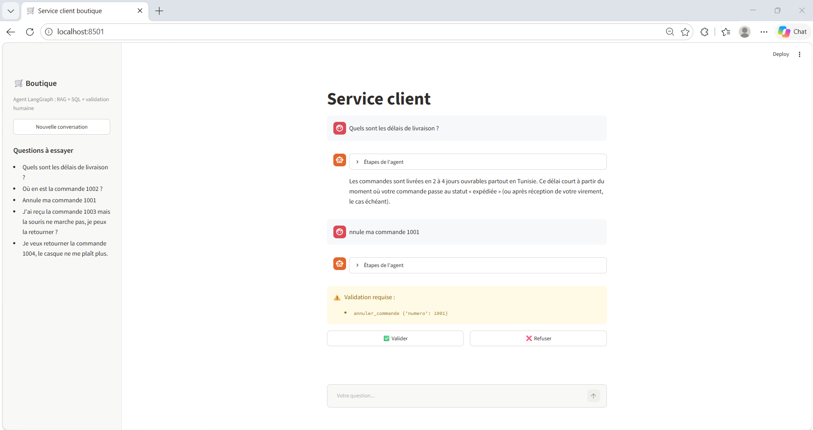
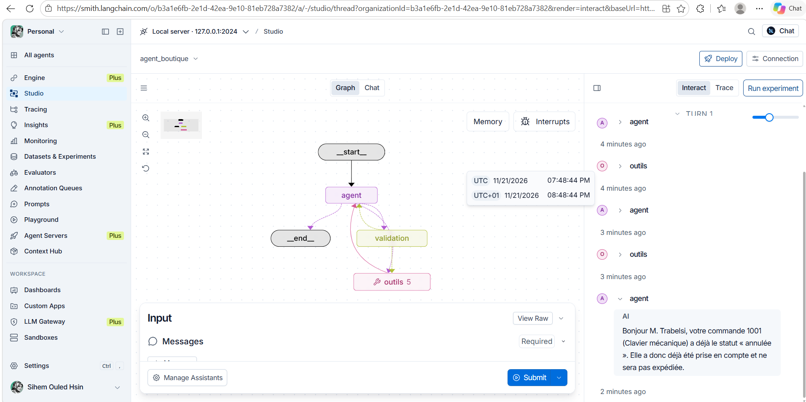

# Agentic RAG Customer Service Assistant

Agent de service client basé sur LangGraph avec RAG (ChromaDB + Gemini), outils SQL SQLite, validation humaine et interface Streamlit.

## Features

- RAG sur les règles de la boutique
- Recherche vectorielle avec ChromaDB
- Gemini comme LLM
- Consultation des commandes SQLite
- Annulation et retour avec validation humaine
- Interface conversationnelle Streamlit

## Architecture

Question utilisateur → LangGraph Agent → RAG / SQL Tools → Human Validation → Response

## Interface



## Visualisation



## Run locally

```bash
uv run indexer.py
uv run streamlit run app_streamlit.py